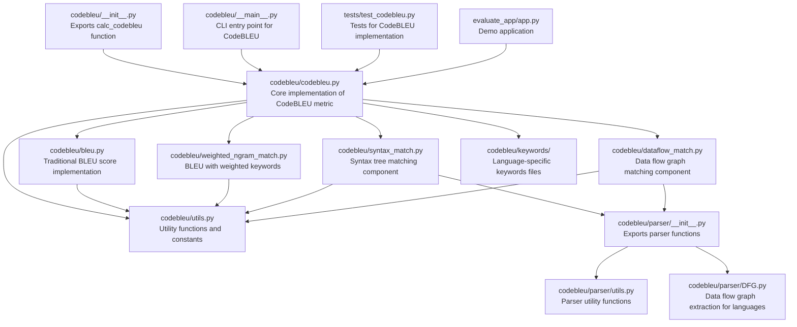

# CodeBLEU Codebase Map

This document provides an overview of the CodeBLEU codebase structure, highlighting key components, their relationships, and functions.

## Repository Structure

## Module Descriptions

### Core Modules

- **codebleu/codebleu.py**: Main implementation of the CodeBLEU metric
  - `calc_codebleu()`: Calculates the CodeBLEU score for code snippets

- **codebleu/__main__.py**: CLI entry point
  - `main()`: Processes command-line inputs and runs CodeBLEU

- **codebleu/utils.py**: Shared utilities
  - `AVAILABLE_LANGS`: List of supported programming languages
  - `pad_sequence()`: Pads sequences for n-gram extraction
  - `ngrams()`: Generates n-grams from a sequence
  - `get_tree_sitter_language()`: Gets the tree-sitter parser for a given language

### Metric Components

- **codebleu/bleu.py**: Standard BLEU implementation
  - `sentence_bleu()`: Calculates BLEU for a single sentence
  - `corpus_bleu()`: Calculates BLEU for a corpus
  - `SmoothingFunction`: Various smoothing techniques for BLEU

- **codebleu/weighted_ngram_match.py**: BLEU with weight for keywords
  - `sentence_bleu()`: Calculates weighted BLEU for a sentence
  - `corpus_bleu()`: Calculates weighted BLEU for a corpus
  - `modified_recall()`: Calculates recall with weighted tokens

- **codebleu/syntax_match.py**: AST-based syntax matching
  - `calc_syntax_match()`: Calculates syntax match for a sentence
  - `corpus_syntax_match()`: Calculates syntax match for a corpus

- **codebleu/dataflow_match.py**: Data flow graph matching
  - `calc_dataflow_match()`: Calculates dataflow match for a sentence
  - `corpus_dataflow_match()`: Calculates dataflow match for a corpus
  - `get_data_flow()`: Extracts data flow graphs from code
  - `normalize_dataflow()`: Normalizes variable names in dataflow

### Parser Components

- **codebleu/parser/utils.py**: Parser utilities
  - `remove_comments_and_docstrings()`: Cleans code
  - `tree_to_token_index()`: Converts parse tree to token indices
  - `index_to_code_token()`: Maps indices to code tokens

- **codebleu/parser/DFG.py**: Data flow graph extraction
  - `DFG_python()`, `DFG_java()`, etc.: Language-specific DFG extractors

### Testing and Demo

- **tests/test_codebleu.py**: Test suite for CodeBLEU
  - Various test cases for different languages and code samples

- **evaluate_app/app.py**: Demo web application
  - Interface for interacting with CodeBLEU metrics

## Data Flow

1. User provides reference and candidate code snippets along with language
2. `calc_codebleu()` computes four component scores:
   - Standard n-gram BLEU score
   - Weighted n-gram score with language keywords
   - Syntax match score using AST representation
   - Data flow match score using variable dependencies
3. Final CodeBLEU score is a weighted combination of these four components